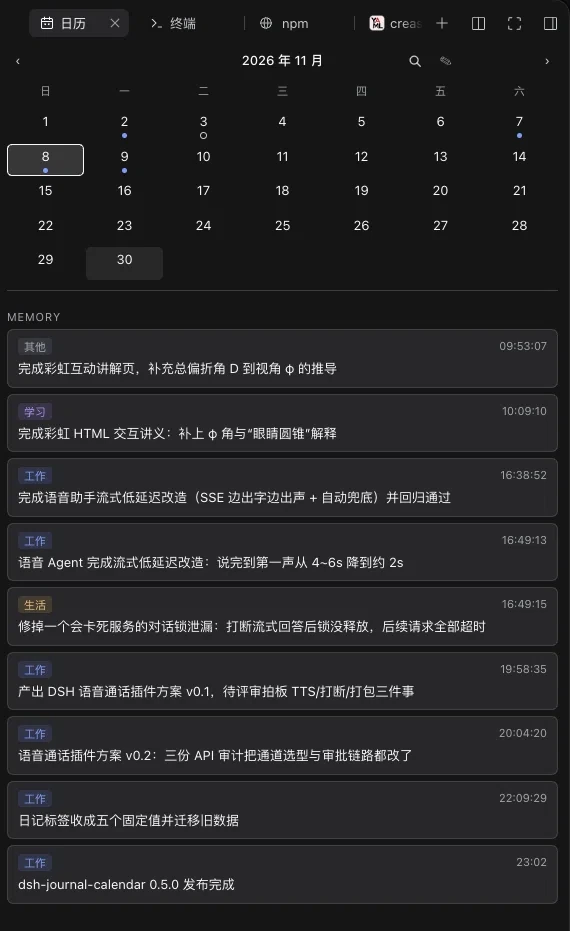
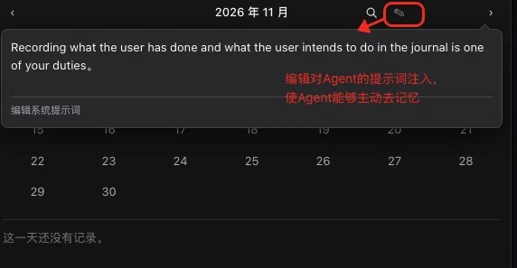
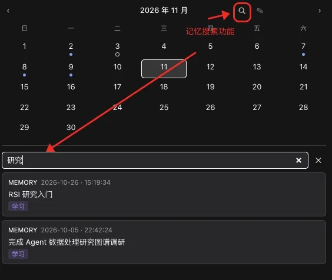

# dsh-journal-calendar

English | [中文](README.zh.md)

A daily journal the agent keeps on its own, for [DeepSeek Harness](https://github.com/deepseek-ai/deepseek-harness) (DSH). One sentence it adds to the system prompt makes recording part of the agent's job, so it writes what you did and what you intend to do into one JSON file per day, and the Web UI draws those files as a calendar in the right sidebar.



## What it does

The plugin registers the `journal_record` tool and one prompt sentence telling the agent that recording is part of its job. The tool takes a `kind` (`todo` = an intention, checkable; `memory` = something that happened), a one-line `title`, one `tag`, and optionally `date` and `time`. Recording the same `id` twice returns the stored entry instead of appending a second one, so a retried tool call is safe.

Everything the agent writes lands on its day in the card, and everything in the card can be driven from the card: the duty sentence is editable there, days are marked by what they hold, entries are searchable, and a memory links back to the conversation that recorded it.

### The duty sentence

The sentence is what makes the recording proactive rather than something you have to ask for. Its default is:

> Recording what the user has done and what the user intends to do in the journal is one of your duties.

It is one prompt section, registered with the tool and gated on the tool's presence, so a profile that removes the tool loses the instruction with it.

That sentence is yours to rewrite. The ✎ button beside the month heading opens a small editor prefilled with the text now in effect; the button turns into ✓ once the draft differs from what is in effect, and committing it saves. Escape, a click outside the editor, or a second ✎ discards the draft. The text lands in `$DSH_HOME/journal/duty.md` (beside the day files, following `dir`), and the **next message** already carries it — the section is re-read on every prompt assembly, so no reload is involved. Saving an empty editor deletes the file and restores the built-in sentence. The limit is 2000 characters, and the text is inserted verbatim, so a `{{` in it is your own writing rather than a variable reference. That is the lever for how eagerly the agent records, and what it considers worth recording.



### The five tags

`tag` is one of five fixed values — `work`, `study`, `life`, `health`, `other` — and the card draws it as a chip: 工作, 学习, 生活, 健康, 其他 in Chinese, Work…Other in English. A closed set is what keeps the journal scannable: with free-form labels it drifted to 342 distinct tags over 227 entries, and every extra one made the chips harder to read. The tool lists the five with what each covers, so the agent can pick one without guessing.

The chip is tinted with its tag's hue — blue for work, violet for study, amber for life, green for health, grey for other — and the same chip appears on a todo row beside the title, so both sections read at one glance. The tint is mixed against the theme's label colour, so the five hues stay legible in the light and the dark surface alike.

Day files written before this change carry free-form `tags` arrays. They are read back as one tag: a label that names one of the five maps to it, anything else becomes `other`, and an entry with no labels keeps none. No file has to be rewritten for the card to work.

### Searching the journal

The magnifier button beside the month heading turns the lower half of the card into a keyword search. It matches every stored entry, memories and todos alike, on title and tag, case-insensitively and newest day first — only what the card draws, so every hit is something you can see; each hit carries its kind, day, and tag. A tag matches by the word the chip shows, in either language, so `工作` and `work` find the same entries. Picking a hit switches the calendar to that day, closes the search, and flashes the entry in the day list. One query stops at 100 hits, so a search cannot stream the whole journal into the sidebar. The scan runs in the Host over the same day files the card already reads; nothing is indexed ahead of time.



### Jumping back to the conversation

An entry recorded from a conversation also stores that Session and the turn it came from, so a memory in the card is a link: clicking one switches to the conversation and scrolls to the turn the entry was recorded in, with a brief highlight. Entries written outside a conversation (hand-edited files, or anything recorded before this existed) carry no source and stay plain text. The scroll addresses turns through the Web client's `data-chat-turn` attribute; if a future client stops publishing it, the click still opens the conversation and simply does not scroll.

### The guide inside the card

The `?` in the month header opens the card's own guide: what gets recorded, the five tags, what each day marker means, checking a todo off, search, the jump back to a conversation, and the duty sentence. It is copy in the same locale dictionaries as the rest of the card, so it follows the interface language and ships no separate page. Clicking the blur, the ✕, or pressing Escape closes it, and opening it replaces whichever of search or the duty editor was open.

## What it contributes

One bundle row mounts all three faces:

| Face | What it is |
|---|---|
| Host service | `journal`, a Remote namespace over `$DSH_HOME/journal` |
| Tool | `journal_record`, plus a standing-duty prompt section |
| Browser half | the calendar card, a right-sidebar tab |

The card shows a month grid with a marker per day, and below it the selected day's `TO DO` and `MEMORY` sections. Todos carry a checkbox that writes straight back to the day file.

## Install

```sh
dsh plugin --profile web add dsh-journal-calendar
```

Then reload the page. The **日历 / Journal** tab appears in the right sidebar.

That resolves the published package from your configured npm registry and ships a prebuilt tarball, so nothing is compiled on your machine and no build authorization is needed. `dsh plugin` forwards to pnpm, so pnpm must be on the machine. Pin a version with `dsh-journal-calendar@0.5.0`. A bare name resolves to the newest release pnpm's supply-chain policy already trusts: that policy holds back any version published less than 24 hours ago, so pin the exact version to install the latest one right after a release. To remove it again:

```sh
dsh plugin --profile web remove dsh-journal-calendar
```

### Installing the release tarball instead

Every release attaches that same prebuilt tarball to its GitHub release, which covers a registry that has not mirrored the release yet:

```sh
dsh plugin --profile web add https://github.com/crease123/dsh-journal-calendar/releases/download/v0.5.0/dsh-journal-calendar-0.5.0.tgz
```

### Installing from the repository instead

Building from source works too, and is what you get before a release exists:

```sh
dsh plugin --profile web add git+https://github.com/crease123/dsh-journal-calendar
```

That fetches **source**, so it builds on your machine. The first attempt stops, because pnpm refuses to run a git-hosted package's build script until you allow that exact package. `dsh` prints the key to paste under `allowBuilds` in the profile's `pnpm-workspace.yaml`; add it and re-run. Treat that authorization as permission for this package's code to run on your machine at install time, and pin a commit (`…#<sha>`) if you want the installed code to stay fixed.

Every path ends at the same prebuilt artifact: the release tarball is byte-identical to the package the registry serves (one sha1 covers both), and both install with no authorization step at all; the `git+https://` install builds on your machine through its authorization step. Each boots with no warnings and reads and writes real day files.

## Where your entries live

One JSON file per day, at `$DSH_HOME/journal/<YYYY-MM-DD>.json` (`~/.dsh/journal` by default). Each file is the complete record of that day:

```json
{
  "version": 1,
  "date": "2026-09-30",
  "entries": [
    { "id": "…", "kind": "todo", "time": "20:00", "title": "跑 2 公里", "done": false }
  ]
}
```

Point it somewhere else by giving the row a `dir`:

```yaml
- id: journal
  name: dsh-journal-calendar
  config:
    dir: /absolute/path/to/journal
```

**Your entries are plain files you own.** Anything that can read JSON can read them, and editing them by hand is supported: keep every entry `id` and the top-level `"version": 1`.

The service treats a file it cannot parse as a hard error rather than rebuilding it, because silently rewriting a day would destroy the record it holds.

## Development

```sh
pnpm install
pnpm run build      # tsc (both faces) then tsdown (both bundles)
pnpm run test
pnpm run typecheck
pnpm pack           # builds, then writes the publishable tarball
```

The repository owns its own tool roots — `pnpm-workspace.yaml` and `vitest.config.ts` exist so pnpm and Vitest do not walk up into an ancestor repository when this package is developed inside a DSH checkout.

### The generated Remote artifacts

`generated/` holds the Typert artifacts (`typert.host.*`, `typert.remote-client.*`) that the Host contributes and the browser bundle inlines. They are **generated, not built here**:

`@deepseek-ai/dsh-typert-generator` discovers contributing packages only under `<root>/packages`, and identifies `TypertRemoteService` by requiring that symbol to be declared in a *registered* package. A package that takes `@deepseek-ai/dsh-typert-protocol` from `node_modules` therefore can never be analyzed in place.

`pnpm run regen-typert` bridges that gap by itself: it copies this repository's `src/` into the checkout under the upstream experimental name, registers the scaffold in the Host aggregate for the length of one run, runs the generator, and restores the checkout byte-for-byte afterwards. Only `packages/typert/generator` must be built in the checkout (`pnpm run build`); the script refuses to emit an artifact that does not name every Remote method this package declares, so a stale copy cannot pass silently:

```sh
DSH_CHECKOUT=/path/to/deepseek-harness pnpm run regen-typert
```

The checkout's `packages/typert/generator` must be built first. Rerun whenever a `@Remote` method's name, signature, or return type changes, or when the Remote error table changes. `scripts/typert-identity.mjs` states the identity rewrite the artifacts need, and `tests/build-artifacts.spec.ts` fails the suite if a regenerated artifact still names the upstream package — the Typert loader rejects such a contribution at boot.

**Restart the DSH host after regenerating.** The Typert loader registers a package's Host face from its `./typert` export and caches the imported manifest per package name for the life of the process, while a hot reload of the package withdraws its strict definitions without committing a replacement. The running card then fails every call with `its strict definition was withdrawn and SRC fallback is forbidden`, even though the artifacts on disk are correct. A restart registers them once, from the new files.

### The publint warning about `./client`

`npx publint` reports one warning: `./lib/client.js` is CommonJS inside a `"type": "module"` package, so Node would read it as ESM.

Leave it. The browser module table fetches that file's bytes and materializes it through `window.__ModuleLoader__.load({ id, factory })`; Node never resolves or imports it, so the extension it is judged by never applies. Renaming it to `.cjs` to silence the warning would depart from every DSH client plugin, all of which ship `lib/client.js` under `"type": "module"`.

## Compatibility

Declared through `peerDependencies` and `engines.dsh`. Verified end to end against DSH `0.2.2-rc.1`: install, boot, bundle delivery, and the `month` / `day` / `setDone` endpoints reading and writing real day files.

The line starts there because the generated Remote contribution imports `@deepseek-ai/dsh-typert-protocol/remote-info`, which protocols before `0.2.1-rc.2` do not export. Older DSH builds are refused at install time rather than failing on the first call.

On Node `22.19.0` and `26.4.0`, the same acceptance run passes and the host artifacts load. Node `24` and `25` sit between two verified versions; `engines.node` names the two release lines DSH itself supports.

Every DSH range names each supported release line explicitly, for example `>=0.2.2-rc.1 <0.3.0-0`. This is not decoration: node-semver only lets a prerelease version satisfy a range when a comparator in that range shares the version's exact `major.minor.patch` tuple *and* carries a prerelease tag itself. A broad-looking `>=0.2.2-rc.1 <0.3.0` silently excludes `0.2.3-rc.1` — pnpm only warns, and the install resolves to something neither side intended. `tests/manifest.spec.ts` pins the ranges to the versions an acceptance run exercised.

DSH reads these ranges at install time and refuses an incompatible plugin, restoring the profile manifest — verified by installing a deliberately-incompatible copy and watching it rejected. But DSH evaluates them with `includePrerelease`, so a range too broad for your package manager still passes there. That asymmetry is exactly why the ranges are pinned by a test instead of eyeballed.

## Publishing

The repository is the source of truth for the npm package and for the community listing.

```sh
npm login --registry https://registry.npmjs.org
npm publish
```

`prepack` builds before the tarball is written, so `npm publish` ships compiled output and installs need no build step. `publishConfig` pins both the public access level and the official registry, because a machine configured against a mirror would otherwise publish somewhere no one else can install from. Check what would ship with `npm publish --dry-run`.

npm requires two-factor authentication for publishing. An account without 2FA — or a token without **Bypass 2FA** — cannot publish directly: the upload lands in the staging area instead (`npm stage publish`), and the version goes live only through `npm stage approve <stage-id>`, which proves presence in the browser. Enabling 2FA on the account is what makes that approval complete; without it, the approval cannot prove anything and the registry rejects it.

To list it in the [dsh-market](https://github.com/dsh-market/dsh-market) plugin market, open a PR that adds **one file** — `data/plugins/crease123__dsh-journal-calendar.yml` — to the [awesome-dsh-plugin](https://github.com/awesome-dsh-plugin/awesome-dsh-plugin) registry:

```yaml
url: https://github.com/crease123/dsh-journal-calendar
name: crease123/dsh-journal-calendar
category: memory
tarball: https://github.com/crease123/dsh-journal-calendar/releases/download/v0.5.0/dsh-journal-calendar-0.5.0.tgz
description:
  en: "A journal the agent keeps on its own: one sentence injected into the system prompt makes recording one of its duties, so it notes what you have done and what you intend to do, and each dated todo or memory lands on its day in the right sidebar's month calendar, marked per day by open todos, finished todos or memories; that injected sentence is editable from the calendar itself, letting you set how eagerly and how the agent records; every entry carries one of five tags (work, study, life, health, other) as a colour-coded chip, todos are checkable, all entries are searchable by title and tag, and clicking a memory opens the session that recorded it and scrolls to that turn; the journal_record tool writes one JSON file per day under the DSH home."
  zh: '助手主动替你维护的每日日志：它往系统提示词里注入一句话，把「记录用户做过的事和打算做的事」列为助手的职责，于是每条带时间的待办或记事都会落到右侧栏月历上对应的那一天，单元格按「有待办未完成 / 待办已完成 / 只有记事」标记；这句话可以直接在日历上改写，用来调整助手记忆的主动性与策略；每条记录带五个标签之一（工作 / 学习 / 生活 / 健康 / 其他）并显示为同色 chip，待办可勾选，全部记录可按标题与标签搜索，点击一条记忆会打开记录它的那次会话并滚动到对应轮次；条目由 journal_record 工具写入 DSH home 下一天一个的 JSON 文件。'
```

The description leads with what the plugin does rather than how it stores it, because the registry already lists `AloneFu/dsh-calendar-plugin`, which also draws a month grid with per-day markers in the sidebar. The difference is what the entries are and who writes them — that plugin views an existing Obsidian vault, while this one has the agent maintain its own day files under the DSH home. A registry reviewer checks an entry against the plugin, and asks whether an existing entry already covers it, so the line has to carry that distinction. Screenshots are declared separately, in this repository's `screenshots.json`, so they can change without another registry pull request.

The registry's `url` must match the repository exactly, and the repository must carry the `dsh-plugin` GitHub topic and be at least one day old. The published package's `repository` field points at the same URL, which is what links the two.

## Known limitations

- **The Web UI is required to see the calendar.** On a headless profile the tool still records entries; nothing draws them.
- **Regenerating the Remote artifacts needs a DSH checkout.** Changing a `@Remote` method's signature is not a self-contained operation here.
- **Days are grouped by the local date of the machine running DSH.** A day file does not carry a timezone, so a laptop that changes timezone mid-travel can attribute an entry to the neighbouring day.
- **Jumping back to a conversation relies on the Web client.** The card locates the turn through the `data-chat-turn` attribute; a client that stops publishing it opens the conversation without scrolling, and entries written before the anchor existed have no source at all.
- **`todo` here is not `todo_write`.** The calendar's todos are durable, one JSON file per day; the built-in `todo_write` tool is a per-session list. Both read as "记录一下" to a model, and no prompt currently distinguishes them.

## License

MIT. See [LICENSE](LICENSE).
