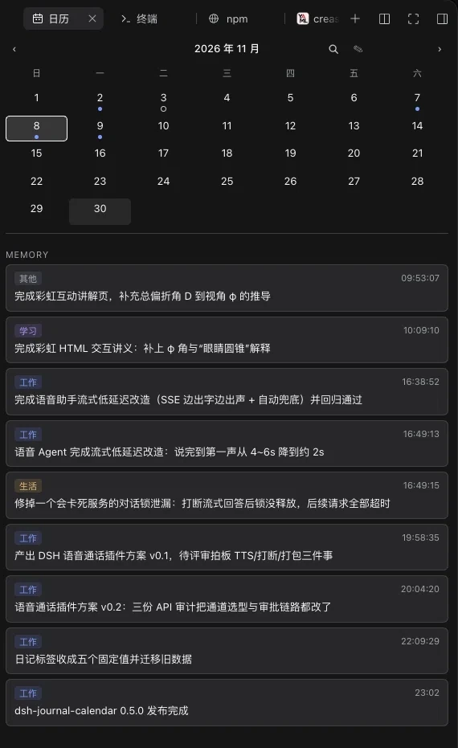
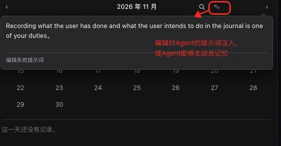
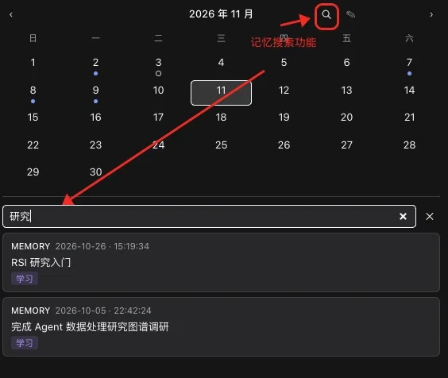

# dsh-journal-calendar

[English](README.md) | 中文

给 [DeepSeek Harness](https://github.com/deepseek-ai/deepseek-harness)（DSH）用的每日日志与日历，由助手主动维护。它往系统提示词里加一句话，把「记录」变成助手的职责之一，于是「你做了什么、你打算做什么」会被写进一天一个的 JSON 文件，Web UI 再把这些文件画成右侧栏里的日历。



如果这个插件对你有帮助，欢迎在 [GitHub 仓库](https://github.com/crease123/dsh-journal-calendar) 点一颗星 —— 月份标题旁的 `?` 打开的就是那一页。

## 目录

当前状态：已在 DSH `0.2.2-rc.1`（Node 22.19.0 / 26.4.0）上验证，最新发布 `0.6.0`。

- [功能介绍](#功能介绍) —— 记录什么、可改的职责提示词、五个标签、搜索、跳回对话、日期标记，以及卡片里那个打开项目仓库的按钮
  - [那句职责提示词](#那句职责提示词) · [五个标签](#五个标签) · [搜索条目](#搜索条目) · [跳回对话](#跳回对话) · [日期标记与勾选](#日期标记与勾选) · [卡片里的那个按钮](#卡片里的那个按钮)
- [它贡献什么](#它贡献什么) —— 一个组合包挂载的三个面
- [安装](#安装) —— 从 npm、从 Release 附件，或从仓库安装
  - [改为装 Release 附件](#改为装-release-附件) · [改为从仓库安装](#改为从仓库安装)
- [记录存在哪](#记录存在哪) —— 日期文件格式与 `dir` 选项
- [维护者](#维护者) —— 开发、兼容性、发布
  - [开发](#开发) —— 构建、测试，以及 Remote 产物怎么生成
    - [生成出来的 Remote 产物](#生成出来的-remote-产物) · [publint 关于 `./client` 的那条警告](#publint-关于-client-的那条警告)
  - [兼容性](#兼容性) —— 已验证的 DSH 与 Node 版本，以及为什么范围要钉死
  - [发布](#发布) —— npm、2FA 暂存发布，以及市场条目
- [已知限制](#已知限制) —— 哪些做不到，以及为什么
- [许可](#许可)

## 功能介绍

插件注册 `journal_record` 工具，外加一句提示词，告诉 agent 记录是它的职责之一。工具参数：`kind`（`todo` = 打算做的事，可勾选；`memory` = 已经发生的事）、单行 `title`、一个 `tag`，以及可选的 `date`、`time`。同一个 `id` 记两次会返回已存在的那条，而不会追加第二条，所以工具调用重试是安全的。

助手写下的每条记录都会落到卡片上对应的那一天，而卡片上的东西也都能从卡片上操作：那句职责提示词可以直接改，日期按内容标记，条目可搜索，一条记忆还能跳回记录它的那次对话。

### 那句职责提示词

它正是「主动记忆」的来源——有了这句话，记录才是助手自己会做的事，而不是等你开口要求。内置的默认句是：

> Recording what the user has done and what the user intends to do in the journal is one of your duties.

它是一段独立的提示词 section，随工具一起注册，并以工具是否存在为开关：把工具从 profile 里去掉，这段指令也跟着消失。

那句话归你写。月份标题旁的 ✎ 按钮会打开一个小编辑器，预填当前生效的文本；草稿与生效文本不同时，按钮变成 ✓，点它就保存。按 Escape、点编辑器外面、或者再点一次 ✎，都会放弃草稿。文本落在 `$DSH_HOME/journal/duty.md`（与每日记录同目录，跟随 `dir`），**下一条消息**就生效——提示词组装时每次重读这个文件，不涉及任何重载。清空后保存会删掉文件、恢复内置句子。上限 2000 字符；文本原样插入，其中的 `{{` 是你自己的文字，不是变量引用。想调整助手记得多主动、什么值得记，调的就是这一句。



### 五个标签

`tag` 只能是五个固定值之一——`work`、`study`、`life`、`health`、`other`，卡片把它画成一枚 chip：中文「工作 / 学习 / 生活 / 健康 / 其他」，英文「Work … Other」。之所以收成封闭集合，是因为日历的价值在于扫一眼就能看懂：用自由标签时，227 条条目里长出了 342 种标签，每多一种，chip 就更难读。工具描述里写清了五个值各自覆盖什么，agent 不用猜。

chip 会带上标签自己的色相——工作是蓝、学习是紫、生活是琥珀、健康是绿、其他是灰——待办行在标题右侧也挂同一枚 chip，两节扫一眼就能分开。底色与文字都跟主题前景色混合，浅色和深色主题下都保持可读。

这次改动之前的日文件里存的是自由 `tags` 数组。读回来时会折算成一个标签：能对应上某个标签的写法直接映射，其余一律记为 `other`，本来就没有标签的条目保持没有。卡片要正常工作，不需要改写任何文件。

### 搜索条目

月份标题旁的放大镜按钮会把卡片下半部分变成关键字搜索。它匹配所有条目（memory 与 todo 一视同仁）的标题与标签，不区分大小写，按日期从新到旧排列——只搜卡片画得出来的东西，所以每条结果都看得见；每条结果都标着自己的类型、日期与标签。标签按 chip 上显示的那个词匹配，两种语言都认，所以「工作」和 `work` 会搜到同一批条目。点一条结果，日历会切到那一天、收起搜索，并在当天列表里短暂高亮这条记录。单次搜索最多返回 100 条，所以一次搜索不会把整本日志灌进侧栏。扫描在 Host 上进行，读的就是卡片本来就在读的那些日文件，没有预先建索引。



### 跳回对话

在对话里记录的条目会同时记下所属 Session 和轮次，因此卡片里的每条 memory 都是一个链接：点一下会切到那次对话，滚到记录这条时所在的那一轮，并短暂高亮。手改 JSON 写进去的、以及这个功能上线前的老条目没有来源，保持纯文本。滚动靠 Web 客户端的 `data-chat-turn` 属性定位；将来客户端不再输出这个属性时，点击仍然会打开那次对话，只是不再滚动。

### 日期标记与勾选

日历格子按内容标记：有待办还没做完是一只空心圈，待办都做完是绿点，只记了 memory 是蓝点，什么都没记就留白。待办行点一下就能翻转完成状态，改动直接写回当天的文件；memory 是发生过的事，没有可勾的东西。

### 卡片里的那个按钮

月份标题旁的 `?` 会在浏览器里打开 GitHub 上的项目仓库 —— 这份 README 就在那里，点星星也只差一下。卡片里因此不再存一份会过期的说明副本。

[↑ 回到目录](#目录)

## 它贡献什么

一行组合包同时挂载三个面：

| 面 | 是什么 |
|---|---|
| Host 服务 | `journal`，覆盖 `$DSH_HOME/journal` 的 Remote 命名空间 |
| 工具 | `journal_record`，以及一条常驻职责提示词段 |
| 浏览器半边 | 日历卡片，一个右侧栏标签页 |

卡片是月历网格 + 每天的标记，下面是所选日期的 `TO DO` 与 `MEMORY` 两段。待办带勾选框，勾选直接写回当天文件。

[↑ 回到目录](#目录)

## 安装

```sh
dsh plugin --profile web add dsh-journal-calendar
```

刷新页面，右侧栏出现 **日历** 标签页。

它从你配置的 npm 源取已发布的包，里面就是预构建产物，**不在你机器上编译，也不需要任何构建授权**。`dsh plugin` 会转发给 pnpm，所以机器上需要 pnpm；要锁版本就写 `dsh-journal-calendar@0.6.0`。裸包名会解析到 pnpm 供应链策略认可的最新版本——该策略会暂缓 24 小时内发布的版本，所以刚发版时要装最新版就写精确版本。卸载：

```sh
dsh plugin --profile web remove dsh-journal-calendar
```

### 改为装 Release 附件

每次发版都会把同一份预构建产物挂到 GitHub Release 上，适合你所用的源还没同步该版本的场合：

```sh
dsh plugin --profile web add https://github.com/crease123/dsh-journal-calendar/releases/download/v0.6.0/dsh-journal-calendar-0.6.0.tgz
```

### 改为从仓库安装

从源码构建同样可行，也是还没有 Release 时的唯一方式：

```sh
dsh plugin --profile web add git+https://github.com/crease123/dsh-journal-calendar
```

这条拉的是**源码**，会在你机器上现场构建。第一次会停下：pnpm 拒绝执行 git 托管包的构建脚本，除非你显式放行那个确切的包。`dsh` 会把该填进 profile 的 `pnpm-workspace.yaml` 里 `allowBuilds` 的键打印出来，填好再重跑即可。请把这项授权理解为「允许这个包的代码在安装时于你的机器上执行」；若想让装上的代码固定不变，就钉住 commit（`…#<sha>`）。

三条路径最终拿到的是同一份预构建产物：Release 附件与 npm 源上那个包逐字节相同（同一个 sha1 可证），两者全程不需要任何授权步骤；`git+https://` 那条在你机器上编译，走一次构建授权。各自启动无警告，并真实读写日期文件。

[↑ 回到目录](#目录)

## 记录存在哪

一天一个 JSON 文件，位于 `$DSH_HOME/journal/<YYYY-MM-DD>.json`（默认 `~/.dsh/journal`）。每个文件就是那一天的完整记录：

```json
{
  "version": 1,
  "date": "2026-09-30",
  "entries": [
    { "id": "…", "kind": "todo", "time": "20:00", "title": "跑 2 公里", "done": false }
  ]
}
```

想换个位置就给那一行加 `dir`：

```yaml
- id: journal
  name: dsh-journal-calendar
  config:
    dir: /absolute/path/to/journal
```

**这些文件是你自己的。** 任何能读 JSON 的东西都能读，手改也支持：保留每个条目的 `id` 和顶层的 `"version": 1` 即可。

服务把读不懂的文件当成硬错误，而不是重建它——静默重写一天，等于毁掉那天留下的记录。

[↑ 回到目录](#目录)

## 维护者

### 开发

```sh
pnpm install
pnpm run build      # tsc（两个面）再 tsdown（两个 bundle）
pnpm run test
pnpm run typecheck
pnpm pack           # 先构建，再打出可分发的 tarball
```

本仓库自带工具根——`pnpm-workspace.yaml` 与 `vitest.config.ts` 的存在，是为了在这个包被放进 DSH checkout 内开发时，pnpm 和 Vitest 不会向上走进上一层仓库。

#### 生成出来的 Remote 产物

`generated/` 存放 Typert 产物（`typert.host.*`、`typert.remote-client.*`），Host 半边导出它们，浏览器 bundle 内联它们。它们是**生成物，不是在这里构建的**：

`@deepseek-ai/dsh-typert-generator` 只在 `<root>/packages` 下发现贡献包，并且通过"该符号必须声明在一个**已注册**包里"来识别 `TypertRemoteService`。因此，从 `node_modules` 取 `@deepseek-ai/dsh-typert-protocol` 的包，没法就地分析。

`pnpm run regen-typert` 自己补上这道缝：它把本仓库的 `src/` 按上游实验包名复制进 checkout，在 Host 聚合里注册这个脚手架跑一次生成器，结束后把 checkout 逐字节还原。checkout 里只有 `packages/typert/generator` 需要先构建（`pnpm run build`）；脚本会拒绝导出缺了任一 Remote 方法名的产物，所以过期副本不会静默通过：

```sh
DSH_CHECKOUT=/path/to/deepseek-harness pnpm run regen-typert
```

checkout 里的 `packages/typert/generator` 必须先构建过。凡是 `@Remote` 方法的名称、签名、返回类型变了，或者 Remote 错误码表变了，就重跑一次。`scripts/typert-identity.mjs` 写明产物需要的身份重写，而 `tests/build-artifacts.spec.ts` 会在重新生成后仍带着上游包名时让测试套件失败——Typert loader 会在启动时拒绝这种贡献。

**重新生成之后要重启 DSH 宿主。** Typert loader 从包的 `./typert` 导出登记 Host 半边，并把 import 到的 manifest 按包名缓存在整个进程生命周期内；而热重载这个包只会撤下它的严格定义、不会补登记。结果是磁盘上的产物明明是对的，运行中的卡片却每次调用都报 `its strict definition was withdrawn and SRC fallback is forbidden`。重启一次，新文件就会被登记。

#### publint 关于 `./client` 的那条警告

`npx publint` 会报一条警告：`./lib/client.js` 是 CommonJS，却位于 `"type": "module"` 的包里，Node 会按 ESM 解读它。

**不要改。** 浏览器模块表取的是这个文件的字节，再经 `window.__ModuleLoader__.load({ id, factory })` 物化；Node 从不解析或导入它，所以「按什么扩展名判定」这件事根本不适用。为了消掉这条警告而改名成 `.cjs`，会偏离所有 DSH 客户端插件的做法——它们全都是 `"type": "module"` 配 `lib/client.js`。

### 兼容性

通过 `peerDependencies` 与 `engines.dsh` 声明。已对 DSH `0.2.2-rc.1` 做过端到端验证：安装、启动、bundle 投递，以及 `month` / `day` / `setDone` 三个端点读写真实日期文件。

起点定在这里，是因为生成的 Remote 产物 import 了 `@deepseek-ai/dsh-typert-protocol/remote-info`，而早于 `0.2.1-rc.2` 的协议没有这个导出。更老的 DSH 会在安装时被拒绝，而不是等到第一次调用才出错。

在 Node `22.19.0` 与 `26.4.0` 上，同一套验收同样通过，宿主产物也能正常加载。Node `24`、`25` 位于两个已验证版本之间；`engines.node` 写的是 DSH 自身支持的两条发布线。

每一条 DSH 范围都显式写出各条受支持的发布线，例如 `>=0.2.2-rc.1 <0.3.0-0`。这不是装饰：node-semver 只有当范围里*某个*比较符与该版本的 `major.minor.patch` 元组完全一致、且自身也带预发布标签时，才放行预发布版本。看起来很宽的 `>=0.2.2-rc.1 <0.3.0` 会静默排除 `0.2.3-rc.1`——pnpm 只会警告，安装结果两边都不符合预期。`tests/manifest.spec.ts` 把范围钉在验收实际跑过的版本上。

DSH 会在安装时读这些范围并拒绝不兼容的插件，同时回滚 profile 清单——这一条用一个故意写成不兼容的副本实测过，确实被拒。但 DSH 是以 `includePrerelease` 求值的，所以一个对你的包管理器来说过宽的范围，在那里照样能过。正是这个不对称，使得范围要靠测试钉死，而不是靠肉眼看。

### 发布

本仓库同时是 npm 包与社区列表的事实来源。

```sh
npm login --registry https://registry.npmjs.org
npm publish
```

`prepack` 会在打包前构建，所以 `npm publish` 发的是编译产物，安装方不需要任何构建步骤。`publishConfig` 同时钉住了 public 访问级别与官方源——机器上若配置了镜像，否则会发到一个别人装不到的地方。用 `npm publish --dry-run` 可以核对究竟会发出什么。

npm 现在要求发布时具备双因素认证。账号没开 2FA、或 token 没勾 **Bypass 2FA**，就发不了直发：上传只会落到暂存区（`npm stage publish`），要靠 `npm stage approve <stage-id>` 在浏览器里证明本人在场，版本才真正上线。账号开启 2FA 才能让这步批准走通；没开的话它证明不了任何东西，注册表一律拒绝。

要进入 [dsh-market](https://github.com/dsh-market/dsh-market) 插件市场，向 [awesome-dsh-plugin](https://github.com/awesome-dsh-plugin/awesome-dsh-plugin) 注册表提一个**只加一个文件**的 PR——`data/plugins/crease123__dsh-journal-calendar.yml`：

```yaml
url: https://github.com/crease123/dsh-journal-calendar
name: crease123/dsh-journal-calendar
category: memory
tarball: https://github.com/crease123/dsh-journal-calendar/releases/download/v0.6.0/dsh-journal-calendar-0.6.0.tgz
description:
  en: "A journal the agent keeps on its own: one sentence injected into the system prompt makes recording one of its duties, so it notes what you have done and what you intend to do, and each dated todo or memory lands on its day in the right sidebar's month calendar, marked per day by open todos, finished todos or memories; that injected sentence is editable from the calendar itself, letting you set how eagerly and how the agent records; every entry carries one of five tags (work, study, life, health, other) as a colour-coded chip, todos are checkable, all entries are searchable by title and tag, and clicking a memory opens the session that recorded it and scrolls to that turn; the journal_record tool writes one JSON file per day under the DSH home."
  zh: '助手主动替你维护的每日日志：它往系统提示词里注入一句话，把「记录用户做过的事和打算做的事」列为助手的职责，于是每条带时间的待办或记事都会落到右侧栏月历上对应的那一天，单元格按「有待办未完成 / 待办已完成 / 只有记事」标记；这句话可以直接在日历上改写，用来调整助手记忆的主动性与策略；每条记录带五个标签之一（工作 / 学习 / 生活 / 健康 / 其他）并显示为同色 chip，待办可勾选，全部记录可按标题与标签搜索，点击一条记忆会打开记录它的那次会话并滚动到对应轮次；条目由 journal_record 工具写入 DSH home 下一天一个的 JSON 文件。'
```

描述从「插件做了什么」写起，而不是从「数据怎么存」写起：注册表里已经有 `AloneFu/dsh-calendar-plugin`，同样在右侧栏画带每日标记的月历。区别在于**条目是什么、由谁写**——那个插件是对已有 Obsidian 知识库的视图，这个则是由助手自己维护 DSH home 下的日期文件。注册表评审会把条目和插件代码对照，并检查是否已被现有条目覆盖，所以这一行必须把区别说清楚。截图另由本仓库的 `screenshots.json` 声明，换图不必再向注册表提 PR。

注册表里的 `url` 必须与仓库完全一致，且仓库需要带上 `dsh-plugin` 这个 GitHub topic、并已创建满一天。已发布包的 `repository` 字段指向同一个地址，这就是两者关联的依据。

[↑ 回到目录](#目录)

## 已知限制

- **要有 Web UI 才看得到日历。** 在 headless profile 上工具照常记录，只是没人把它画出来。
- **重新生成 Remote 产物需要一份 DSH checkout。** 改动 `@Remote` 方法签名不是一件自包含的操作。
- **按运行 DSH 那台机器的本地日期分天。** 日期文件不携带时区，所以旅途中切换时区的笔记本可能把一条记录归到相邻的一天。
- **跳回对话依赖 Web 客户端。** 卡片靠 `data-chat-turn` 属性定位轮次；客户端不再输出这个属性时只会打开对话而不滚动，而在锚点出现之前写入的条目干脆没有来源。
- **这里的 `todo` 不是 `todo_write`。** 日历的待办是持久的、一天一个 JSON 文件；内置的 `todo_write` 工具是会话内的清单。对模型来说两者都读作"记录一下"，目前没有提示词区分它们。

[↑ 回到目录](#目录)

## 许可

MIT，见 [LICENSE](LICENSE)。
